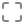

# AI Crew

<p align="center">
  
</p>

> Give the AI its own screen.

AI Crew lets you run an AI agent inside a real desktop environment. The agent works on its own display — reading and writing files, executing code, running shell commands, taking screenshots, and capturing apps or the browser — while you watch everything live through a noVNC iframe. You can jump in at any time and take over the machine directly, with full mouse and keyboard input.

##  How it works

-  **The AI has its own screen.** The agent operates inside a virtual desktop instead of just chatting in a terminal. You see exactly what it sees, in real time.
-  **Watch live.** The AI's screen is streamed over VNC and embedded in the app as a noVNC iframe — no plugins or extra clients required.
-  **Take over.** Switch into takeover mode to interact with the same desktop the AI is using. Fullscreen takeover runs over the same VNC session with input enabled, so you can click, type, and drive the machine yourself.

##  Features

-  **File operations** — the AI can read and write files on its own desktop
-  **Code execution** — run scripts and programs directly in the environment
-  **Shell access** — full shell command execution
-  **Screenshots** — capture the current state of the AI's screen
-  **App / browser capture** — grab specific applications or browser windows
-  **Live screen view** — watch the AI work through an embedded noVNC iframe
-  **Fullscreen takeover** — take remote control of the AI's session with input enabled

##  Tech stack

-  [Next.js](https://nextjs.org) (App Router) + React 19 + TypeScript
-  Tailwind CSS v4 + [shadcn/ui](https://ui.shadcn.com) (Base UI)
-  noVNC for browser-based VNC viewing and control

##  Getting started

Install dependencies:

```bash
npm install
```

Start the dev server:

```bash
npm run dev
```

Open [http://localhost:3000](http://localhost:3000) in your browser.

##  Scripts

| Command             | Description                    |
| ------------------- | ------------------------------ |
| `npm run dev`       | Start the development server   |
| `npm run build`     | Production build               |
| `npm run start`     | Serve the production build     |
| `npm run lint`      | Run ESLint                     |
| `npm run typecheck` | Run the TypeScript compiler    |
| `npm run format`    | Format files with Prettier     |

##  Adding UI components

To add shadcn/ui components to the app:

```bash
npx shadcn@latest add button
```

Then import them where needed:

```tsx
import { Button } from "@/components/ui/button";
```
